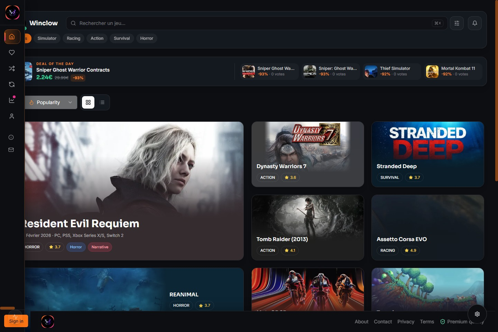
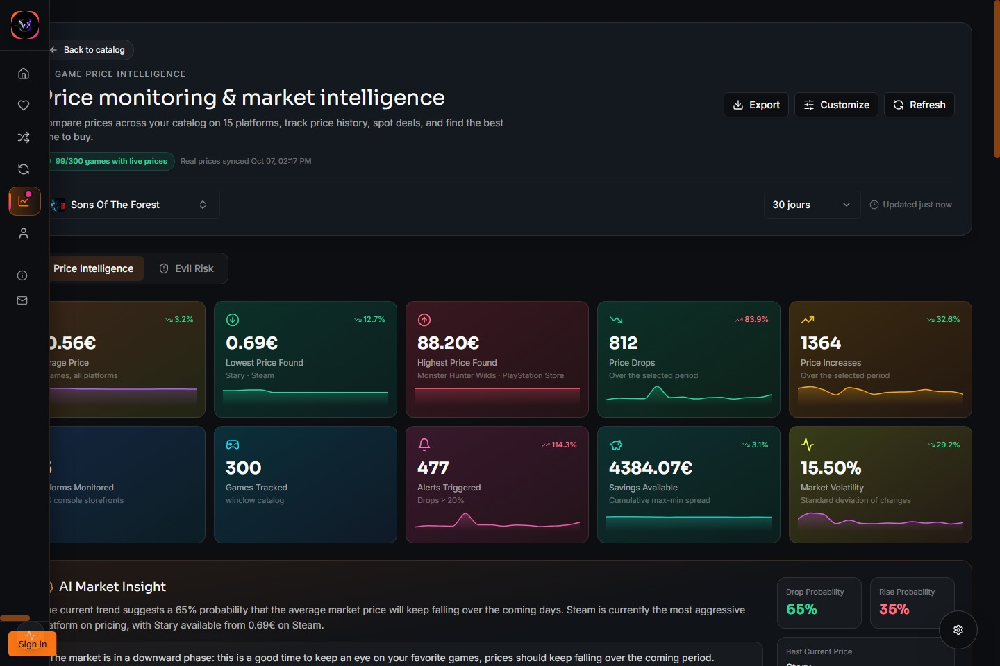
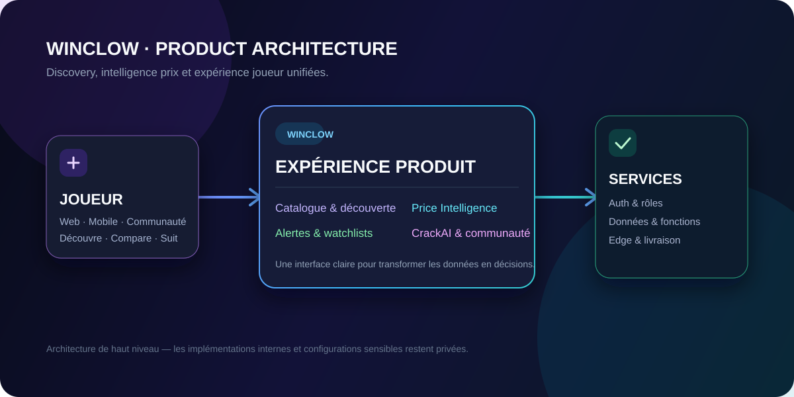

  

  <h1>Winclow</h1>
  
<strong>Game intelligence for better decisions.</strong>

  
Discover what to play. Understand when to buy. Keep every opportunity in view.

  

    <a href="https://winclow.com"><strong>Explore Winclow ↗</strong></a>
    &nbsp;·&nbsp;
    <a href="#inside-winclow">Product tour</a>
    &nbsp;·&nbsp;
    <a href="#technology">Technology</a>
  

---

## The game market is vast. The right decision should feel simple.

Winclow is a game discovery and market-intelligence platform. It brings together the signals players need to choose their next game with confidence: a curated catalogue, live market context, price history, deal monitoring, personal watchlists and a discovery assistant.

It is not another storefront. It is the layer between the catalogue and the decision.

  
   
  Discover — Search a living catalogue, filter by intent and surface high-value deals.

## Inside Winclow

### 01 — Discover with context

Winclow turns a game catalogue into an exploration surface.

- Search the catalogue instantly and narrow results by category or preference.
- Browse rich game cards with platform, release, genre and rating signals.
- Find high-impact offers through a daily-deal surface instead of hunting across tabs.
- Save titles to favourites and build lists around your own playing intent.

### 02 — See the market, not just the price

The **Price Intelligence** workspace translates raw storefront data into a practical buying signal.

- Compare prices across monitored stores and platforms.
- Read price history, volatility and recent market movement at a glance.
- Identify the lowest observed price, the best current offer and savings opportunities.
- Follow personal price targets and receive a signal when the market reaches them.

  
   
  Price Intelligence — A complete decision surface for prices, trends, alerts and opportunity.

### 03 — Keep your game universe organised

Winclow connects discovery to action.

| Capability | What it enables |
| --- | --- |
| **Watchlists & alerts** | Track the games that matter and set a price threshold worth acting on. |
| **Profiles & collections** | Build a personal library of favourites, lists and community-facing collections. |
| **News & updates** | Stay close to relevant updates, announcements and game activity. |
| **CrackAI** | Ask for game ideas in natural language and receive catalogue-aware, market-informed guidance. |
| **Admin workspace** | Manage catalogue data, store links, roles, content, subscriptions and platform operations. |

## Designed as a product system

Winclow is built around a simple principle: **every meaningful piece of information should move the player closer to a good decision.**

That means a premium dark interface without the usual noise; real states for loading, empty and failure conditions; responsive interaction across screens; and product controls that remain understandable when the data gets dense.

  

## Technology

| Layer | Foundation |
| --- | --- |
| Product interface | React, TypeScript, Vite, Tailwind CSS and accessible UI primitives |
| Product data | Supabase, PostgreSQL, Row Level Security and serverless functions |
| Identity & payments | Clerk authentication and Stripe billing |
| Data experience | TanStack Query, real-time product state and structured market data |
| Delivery | Cloudflare Workers and Static Assets |
| Media | Cloudinary |

## Private by design

This repository is the public home of the Winclow product story. It is intentionally a **showcase repository**: it contains no application source code, operational configuration, credentials or internal infrastructure.

The product’s implementation remains private so the team can protect its intellectual property, security posture and operational systems while still presenting the platform with clarity.

If you discover a security concern, please read [our security policy](SECURITY.md) before reporting it.

## Explore

  <a href="https://winclow.com"><strong>Visit winclow.com ↗</strong></a>
    
  Winclow is independently developed. Product and platform names mentioned in this repository are trademarks of their respective owners.

